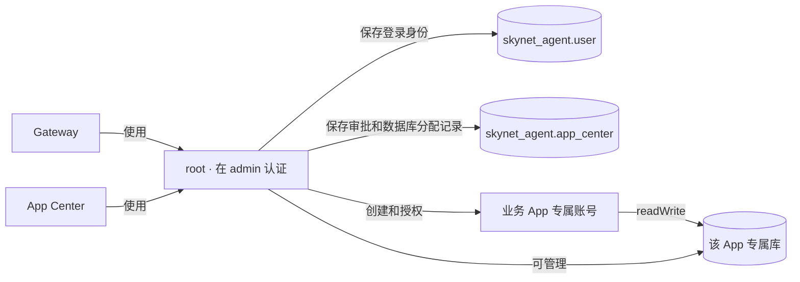

# 配置说明

服务端配置位于 `server/etc/cfg/`。客户端在宿主登录页填写网关地址与用户名。
本文说明配置方式、可用值与生效条件；首次启动见[项目首页](../README.md#快速开始)。

## 环境文件

将 `server/.env.example` 复制为 `server/.env`，填写模型 API Key，并设置 MongoDB 实例管理员的密码。该文件使用 shell 兼容语法，
由 `server/start.sh` 加载；只保存本机密钥和环境选择，不提交真实密钥。可用环境变量如下：

| 变量                   | 用途与可用值                                                                             |
| ---------------------- | ---------------------------------------------------------------------------------------- |
| `SKYNET_ENV_FILE`      | 启动脚本读取的环境文件路径；未指定时读取 `server/.env`，需在启动脚本前设置               |
| `SKYNET_CFG_CHANNEL`   | 渠道文件名，省略时使用 `develop`；以字母开头，仅含字母、数字、下划线，且渠道文件必须存在 |
| `DEEPSEEK_API_KEY`     | App Center 在创建内置 Agent 容器时传入的模型密钥 |
| `DEEPSEEK_BASE_URL`    | 开发渠道的模型服务地址                                                                   |
| `DEEPSEEK_MODEL`       | 开发渠道的模型名称及新会话默认模型 ID；该 ID 必须存在于模型清单                          |
| `AGENT_WORKSPACE_ROOT` | 云端会话工作目录的根路径                                                                 |
| `APP_CENTER_ADMIN_TOKEN` | 应用中心的管理员解锁令牌。省略时只开放普通目录查询。 |
| `GATEWAY_PORT` | 主机回环端口，默认 18787 |
| `APP_CENTER_PORT`、`GATEWAY_CLUSTER_PORT` | 两个基础节点的本机 Cluster 端口，默认分别为 18081、18082。每套部署须使用独立的可用端口。 |
| `MONGO_HOST`、`MONGO_PORT` | Gateway、App Center 与业务 App 使用的 MongoDB 实例地址，默认 `127.0.0.1:18083`。 |
| `MONGO_ROOT_PASSWORD` | 实例管理员 `root` 的密码，认证库为 `admin`。Compose 将此密码提供给 MongoDB、Gateway 和 App Center。 |
| `APP_ID`、`APP_SCHEMA`、`APP_INSTANCES` | 应用容器的稳定标识、独立协议入口和 Actor 数量，数量范围 1–32 |
| `AGENT_TOOL_TCP_PORTS` | 容器内默认沙盒工具可连接的 TCP 端口，逗号分隔，默认 `53,80,443`。预留节点控制与 Cluster 端口 `18000,18081,18082`。 |

密钥由服务端持有，不传给客户端。当前接入 DeepSeek；模型服务需要支持项目使用的 Responses API、
流式输出与工具调用，不能仅凭 OpenAI 兼容的声明判断可用性。

## 渠道与配置加载

`server/etc/cfg/init.lua` 根据渠道选择 `channel/<name>.lua`，与 `common.lua` 深度合并并统一校验。
渠道中的 `agent.models` 整体替换公共模型清单。配置在进程启动时加载，变更后重启。
环境变量的读取仅在配置初始化层进行，业务代码通过配置模块获取值。

Skynet 线程与启动配置位于 `server/etc/config`。各工作池的实例数未指定时取工作线程数，
也可在渠道配置中分别覆盖。

### 运行与网关

| 配置                                | 可用值与含义                         |
| ----------------------------------- | ------------------------------------ |
| `runtime.control_port`              | 1–65535 的整数；控制台仅监听回环地址 |
| `runtime.executable_search_path`    | 工具子进程的可执行文件搜索路径字符串 |
| `protocol.agent_gateway_schema_dir` | 非空 schema 目录路径                 |
| `agent_gateway.socket.host`         | 非空监听地址                         |
| `agent_gateway.socket.port`         | 1–65535 的整数                       |
| `agent_gateway.socket.path`         | 以 `/` 开头的 WebSocket 路径         |
| `application.instances`             | 每个应用节点的业务实例数，范围 1–32。容器指定的 `APP_INSTANCES` 优先于渠道默认值 |
| `agent_gateway.instance.client`     | 1–32 的整数                          |
| `agent_gateway.instance.logind`     | 1–32 的整数                          |
| `agent_gateway.instance.websocket`  | 1–32 的整数                          |
| `agent_gateway.login_timeout_ticks` | 正整数；未完成登录连接的存活时间     |

Agent 的工作目录 `/work` 使用项目专属的 `<项目名>_agent-work` 卷。MongoDB 使用 `mongo-data` 卷持久保存数据和账号。首次初始化时，MongoDB 用 `MONGO_ROOT_PASSWORD` 创建实例管理员。复用已有数据卷时填写该账号的当前密码，改密时同步更新 MongoDB 和环境文件。`cluster-key` 卷供 App Center 和 Gateway 使用。

首次批准时，App Center 创建专属账号，核对权限，再用该账号登录并在目标库创建空集合 `_app_center`。成功后，App Center 在同一次写入中确认审批，并将库名、用户名、密码和状态保存到 `skynet_agent.app_center` 的顶层 `database` 字段。创建失败时申请保持待审。创建期间的私有字段 `database_request` 用于重试，成功后清除。

创建业务容器时，App Center 将实例地址与该 App 的专属库名、认证库、账号和密码组装成 `APP_DATABASE_CONFIG`，由业务节点的 `config.database` 读取。该启动参数由部署脚本注入。专属账号在 `app_credentials` 认证，仅有自己数据库的 `readWrite` 权限。停用、重启和升级复用该记录。下架后旧库名保存在 `archived_databases`，再次批准会分配空库。

### MongoDB 账号关系

Gateway 首次登录时按规范化用户名创建用户记录，同名用户在网关重启后仍取得同一个 `user_id`。用 Compass 查看所有库时，填写本机实例地址、用户名 `root`、认证库 `admin`，密码取自 `server/.env` 的 `MONGO_ROOT_PASSWORD`。

### 模型与会话

| 配置                                   | 可用值与含义                                                    |
| -------------------------------------- | --------------------------------------------------------------- |
| `agent.llm.api_key`                    | 模型密钥；设置时须为非空字符串                                  |
| `agent.llm.base_url`                   | 非空模型服务地址                                                |
| `agent.llm.model`                      | 非空模型名称                                                    |
| `agent.llm.request_timeout_ticks`      | 正整数；覆盖发送到流结束的请求总时长                            |
| `agent.models`                         | 有序模型清单，每项提供非空的 `id`、`name`、`model`，ID 不可重复 |
| `agent.default_model_id`               | 模型清单中的 ID，指定新会话默认模型                             |
| `agent.max_message_length`             | 正整数；客户端输入文本长度上限                                  |
| `agent.session_title_length`           | 正整数；会话标题长度上限                                        |
| `agent.project_instructions_max_bytes` | 非负整数；根项目规则的字节上限，`0` 关闭自动加载                |

模型清单的每项可覆盖 `agent.llm` 的连接默认值。客户端只获得公开模型描述，可按会话选择模型。
运行中的模型请求继续使用已取得的配置，后续请求使用新选择；权限模型由下文配置决定。
对话与模型生命周期见[会话模型与思考流](architecture/AGENT_GATEWAY.md#会话模型与思考流)，
根规则选择、超限与读取失败行为见[项目规则](architecture/PROMPTS.md#项目规则)。

### 工具与权限

| 配置                             | 可用值与含义                                                   |
| -------------------------------- | -------------------------------------------------------------- |
| `agent.tools.workspace_root`     | 非空路径；云端工作目录根路径，可由 `AGENT_WORKSPACE_ROOT` 提供 |
| `agent.tools.timeout_ms`         | 1–3600000 的整数；工具进程执行期限，单位毫秒                   |
| `agent.tools.max_processes`      | 1–64 的整数；会话进程数量上限                                  |
| `agent.tools.max_output_bytes`   | 4096–4194304 的整数；输出字节上限                              |
| `agent.permission.rules_enabled` | `true` 或 `false`；是否启用规则拦截                            |
| `agent.permission.deny_patterns` | 可选字符串数组；每项为有效 Lua pattern，用于禁止规则           |
| `agent.permission.model_id`      | 可选模型清单 ID；省略时跟随会话模型                            |
| `agent.permission.timeout_ticks` | 1–12000 的整数；独立权限判断超时                               |

所有 `_ticks` 字段单位为厘秒，工具执行的 `timeout_ms` 单位为毫秒。工具调用次数不设上限。
规则只能阻止动作，通过规则后仍逐次调用独立权限模型；拒绝、失败或判断无效均不执行工具，
也不转交人工审批。关闭规则拦截不会关闭模型判断或系统沙盒。

工具参数 `sandbox_permissions` 可取 `use_default`、`require_escalated`；沙盒外执行需提供
`justification` 并通过权限判断。默认沙盒允许联网，写入限制在会话工作目录。
文件独立保留在磁盘，不随清空聊天历史或服务端重启自动删除。

macOS 客户端支持桌面执行目标、目录绑定和工具回执。Agent 停用期间可在原连接交付已发出工具请求的回执。
执行、取消、重试和授权机制见[工具执行与权限](architecture/AGENT_GATEWAY.md#工具执行与权限)。

## 客户端偏好

外观可选跟随系统、浅色和深色；壁纸可选海岸、暮色和森林；减少动态效果为开关。
这些设置由原生宿主原子保存，保存成功后统一发布到工作区与各应用。
存储不可用时拒绝变更并显示反馈。系统主题与减少动态效果参与界面适配。
macOS 宿主将数据保存在 Application Support 下的 `Skynet Agent` 目录。每个应用只能通过宿主访问自己的状态。

宿主持有已登录用户的身份。Agent 和应用中心使用同一登录信息。退出登录后可更换服务器或用户名。
普通应用网络来源须列入 manifest 的 `networkOrigins`。远程服务器使用精确 `wss` 来源。
本机目录、服务器来源授权和远程执行开关由原生宿主保存。
连接、快照合并与中断规则见 [Agent 客户端](architecture/CLIENT_AGENT.md)。

## 部署边界

本机回环连接可使用 `ws://`，其他地址使用 `wss://`，由反向代理终止 TLS 后转发到网关。
模型密钥只由服务端使用，不写入客户端环境文件。

当前仅按用户名识别用户，没有密码认证，非回环监听限于受控网络。公网发布前需要认证、授权、
限流和连接配额。聊天数据只保留在进程内存，服务端重启后清空；会话目录中的文件独立保留。
