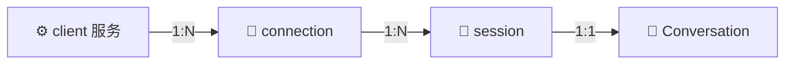
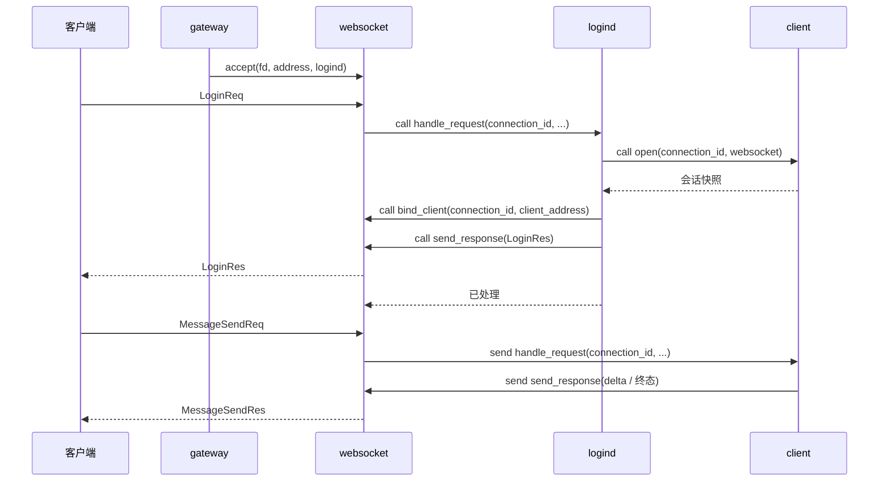

# Agent WebSocket 网关

## 边界

Web 和 Tauri 客户端通过 WebSocket 连接 Skynet。模型对话、会话历史、模型配置和 API Key
都位于服务端；客户端持有展示状态。每个连接拥有独立的短期会话集合，断线、重启或退出后不恢复。
当前不提供账号、跨设备同步或持久历史。

## 术语与职责

| 名称 | 含义 |
| --- | --- |
| `client` | 承载客户端业务的 Skynet 服务，一个实例可以管理多条连接 |
| `connection` | 单条客户端连接及其业务上下文 |
| `session` | 聊天会话，保存消息与对话历史 |
| `Conversation` | 模型调用与历史管理对象，由 `agent.conversation` 导出 |
| `user` | 预留给用户身份概念 |
| `Agent` | 保留给智能体业务概念，实体模型后续设计 |

服务池实例数表示承载容量；连接数、用户数与智能体数分别描述。当前模型对话对象不承担独立智能体身份。
`config.agent`、`agent_gateway`、`skynet.agent.v1` 和 `/agent` 继续用于智能体业务配置或协议命名。

## 服务生命周期

`main` 是进程的生命周期所有者，持有共享 Protobuf schema 和服务地址列表。它按依赖顺序创建、
命名和初始化服务，最后开放网关监听；启动失败则回收已创建服务。本机控制台在业务服务启动前开放，
启动卡住时也可显式强制关闭。关闭时先停止热修监听并等待当前批次结束，再停止接入、依次回收
WebSocket、登录和 client 服务，等待在途命令、连接读循环和后台生成退出后统一结束进程。
启动和关闭均无超时，正常关闭保留服务 VM 至进程结束。清理成功退出 0，清理失败退出 1；
显式强制关闭跳过清理并退出 1。进程重启由外部管理器负责。

| 目录 / 服务                                      | 职责                                                       |
| ------------------------------------------------ | ---------------------------------------------------------- |
| `base/service.lua`                               | 命令白名单、上下文、初始化、状态、关闭、异常边界、热修注册 |
| `service/init.lua`                               | 根据 loader 提供的服务名加载业务主体                      |
| `main.lua`                                      | 业务 schema、服务数量、依赖顺序和初始化参数              |
| `base/node.lua` / `main`                         | 公共初始化、服务登记、启动失败回收、状态汇总、进程关闭   |
| `base/rpc.lua`                                   | 固定 Lua 协议、有超时与无超时调用、状态码、完整多返回值    |
| `helper/`                                        | Protobuf 加载与接入、服务池轮询、开发渠道热修监听          |
| `service/gateway/gateway.lua` / `gateway`        | 单例监听和新连接分发                                       |
| `service/websocket/websocket.lua` / `websocket`  | 连接生命周期、编解码、协议守卫、写队列和消息路由           |
| `service/logind/logind.lua` / `logind`           | 分配 client 服务、初始化连接、绑定、登录响应、失败关闭           |
| `service/client/client.lua` / `client`             | 连接业务路由、会话和模型请求                               |
| `client/connection.lua`、`agent/conversation.lua` | 客户端会话状态、模型对话与历史提交                         |

`src/service/init.lua` 是公共业务入口，统一调用 `service.start(SERVICE_NAME)`。
独立脚本和 Skynet 内置服务优先于公共入口。`src/service/<name>/<name>.lua` 返回稳定类表，
使用服务名作为唯一模块名，例如 `require("gateway")`。
`src/lualib` 保存服务创建的对象与公共模块。各节点的 main 通过 `node.init(callback)` 定制业务启动，
回调接收节点实例；`node` 先完成公共初始化，再执行回调，最后进入就绪状态。
`node` 复用服务基础层的初始化与命令分发，统一管理进程生命周期，业务服务清单由 main 决定。
节点实例的 `launch(name, count, params, registered_name)` 默认按服务名和编号注册；
单实例可指定注册名，网关的 `.gateway` 由 main 显式传入。
基础目录加入搜索路径后，以 `class`、`rpc`、`service` 等短名加载模块。
Skynet 每个服务 VM 和 Busted 都先执行统一预加载脚本，将 `luaext.table` 的复制方法扩展到标准库，
业务代码直接调用 `table.copy`、`table.deep_copy`。
业务类的 `commands` 把公开命令映射到方法名，执行时动态查找方法；`ctor` 和私有方法不会直接暴露。
方法第一参是 `{source, session}` 上下文，后面是业务参数。基础层只对同步调用发送返回值，
返回格式为 `状态码, 业务结果...`；Lua 异常会被记录并转换为 `call_fail`。

初始化只能执行一次。服务就绪前拒绝业务命令；初始化期间仅放行 `initializing_commands` 显式登记的
命令，main 只登记 `force_shutdown`。关闭由初始化所有者发起并保持幂等。
`close` 成功表示清理完成，重复调用等待同一次结果。关闭期间拒绝新业务，仅允许
`closing_commands` 显式登记的收尾命令，例如回收迟到的接入 fd 和断线清理。
在途命令异常也会释放计数，client 服务的独立请求集合继续跟踪已断开连接的后台生成。

关服与用户取消都会主动关闭已有模型响应流，并等待生成协程收尾；取消确认先于取消终态。
底层 HTTP 在连接建立及响应头返回前没有可用流句柄，此阶段先标记取消，取得流后立即释放；
模型请求超时仍生效，关服等待不另设截止时间。请求上下文通过稳定 Client 类传给 HTTP 兼容层，
各请求互不串扰。
基础层不对整个服务加串行锁，因为同一服务中的其他连接及跨服务回调必须继续运行。
长期对象的状态保存在实例中，方法位于模块导出的稳定类表，长期回调通过 `self:method()` 查找实现。
结构、接口、schema 和配置变化通过重启发布；后续兼容的缺陷修复才使用热修。
服务主体也通过稳定模块表热修，例如 `dbgcmd .gateway HOTFIX gateway`。
`node` 导出稳定的 `Node` 类表，公共运行期方法的缺陷修复可使用 `dbgcmd .main HOTFIX node`。
节点启动回调只执行一次，不保存在节点实例中；业务编排与公共启动流程的调整通过重启生效。
`develop` 渠道由 node 在业务服务启动完成后创建 `helper.hotfix_watch` 并建立源码基线，
在节点内协程轮询文件内容，连续保存稳定后串行发起批次。目标是 `.main` 与全部登记且已就绪的业务实例，
运行期新建实例加入后续批次。其他渠道不自动监听。
监听同时覆盖库文件与服务主体，基础目录文件映射为短模块名；排除主入口、公共服务入口、
热修器、监听器自身、预加载脚本和标准库扩展。这些启动代码以及新增、删除文件的变更通过重启生效。
节点先合并本次变更和失败实例积压的模块，对扫描到的源码内容进行编译，不执行候选函数。
任一文件语法错误都阻止整批分发，保留全部待更新模块供后续保存时重试。
通过预检查后，每个 VM 独立执行模块、校验并提交整批方法替换，返回 `updated` 和 `skipped` 模块列表；
某实例失败或响应超时，其完整待更新模块集保留至后续源码变更时合并重试，其他实例仍可完成更新。
服务不单独记录热修日志。节点根据实际更新结果，将模块映射为文件路径、去重排序，统一记录一次；
失败或部分成功也只输出一次汇总，全部跳过时不输出成功日志。
节点关闭先停止监听并等待在途批次结束，之后再清理业务服务。

内部调用使用 `rpc.call`、`call_no_timeout` 和 `send`。`call` 有默认超时，`call_no_timeout`
用于无超时等待服务初始化和清理完成。RPC 不自动重试：超时表示调用方停止等待，远端仍可能完成。
`send` 成功仅表示消息已交给 Skynet，不能当作远端执行确认。

管理命令为 `make server-status`、`make server-stop` 和 `make server-force-stop`。
它们通过回环地址的控制台访问 `.main`；普通关闭等待清理完成，强制关闭可在启动、运行或关服等待期间
由脚本显式触发，重复触发保持幂等。控制响应表示命令已接收，进程退出码表示最终结果。
`CONTROL_PORT` 可以覆盖目标端口。工作服务使用 `.client_1`、`.logind_1`、`.websocket_1` 等注册名，
网关使用 `.gateway`。状态查询并行收集服务状态，失联服务显示 `unavailable`。

## 连接与内部消息

WebSocket 只按连接是否绑定 client 服务选择路由。未绑定时同步等待 logind，暂停当前连接的读取；
其他连接仍可并发处理，logind 对 WebSocket 的绑定和写入回调也能执行。绑定后异步转发给 client 服务。
`logind` 不保存连接级登录状态，也不参与登录后的转发。

登录严格按 `client.open → websocket.bind_client → websocket.send_response(LoginRes)` 编排。
绑定先于成功响应，客户端收到成功响应后可以立即发送业务消息。失败时先同步写响应，再关闭连接；
绑定前失败由 logind 清理新建客户端上下文，绑定后断线或写入失败由 WebSocket 通知 client 服务。
调用超时或处理结果不是 `true` 时，WebSocket 以 1011 关闭连接。

每次接入生成独立 `connection_id`，服务之间用该标识操作连接，fd 只用于本地 socket。
迟到回调、超时回调和写队列执行前都检查连接对象身份，避免 fd 复用时影响新连接。
连接移除与 client 服务断线通知至多发生一次。登录超时从接入开始计时，覆盖未完成握手的连接。

WebSocket 提供以下通用命令，第一参均为基础层上下文：

- `bind_client(connection_id, client_address)`：绑定存活连接，拒绝覆盖其他 client 服务。
- `send_response(connection_id, message_id, name, args)`：编码并串行写入；写完返回 `true`。
- `close_connection(connection_id, code, reason)`：移除连接、通知 client 服务并关闭；重复操作无副作用。

client 服务以 WebSocket 的消息来源地址校验连接归属，通过白名单分发业务请求。
未知业务请求（包括重复登录）以 1008 关闭，处理异常以 1011 关闭。

## 配置与传输

服务器配置由 `server/etc/cfg/common.lua` 和 `channel/<name>.lua` 合并并统一校验，渠道通过
`SKYNET_CFG_CHANNEL` 选择。配置在启动时加载，变更后重启。

| 配置                                | 可用值 / 含义                                                               |
| ----------------------------------- | --------------------------------------------------------------------------- |
| `runtime.control_port`              | 1..65535，仅回环监听的管理端口                                              |
| `agent_gateway.socket`              | `host`、`port`、以 `/` 开头的 `path`                                        |
| `agent_gateway.instance`            | `client`、`logind`、`websocket` 各为 1..32                                   |
| `agent_gateway.login_timeout_ticks` | 正整数，未绑定连接的存活时间                                                |
| `agent.llm`                         | `api_key`、`base_url`、`model`、正整数 `request_timeout_ticks`              |
| `agent`                             | 非空 `system_prompt`，正整数 `max_message_length` 与 `session_title_length` |
| `protocol.agent_gateway_schema_dir` | schema 目录                                                                 |

所有 `_ticks` 时间单位为厘秒。模型请求使用从发送到流结束的总截止时间，包含停滞流；超时后关闭
供应商连接并释放本轮占用。模型截止时间应小于客户端流式请求的等待时间。
本地回环连接可使用 `ws://`，其他地址必须使用 `wss://`，由反向代理终止 TLS。

`helper.protobuf.load` 只由 main 执行。消费者初始化时 `attach` 共享只读 schema，再由各自 VM 中的
`network.protocol` 对象建立本地类型映射。require 顶层不进行文件读取或切换 Protobuf 状态。
main 在整个进程生命周期内存活，不提前释放 schema。

## 外部消息格式

共享协议位于 `common/proto`，客户端生成代码位于 `client/src/protocol/generated`。
修改后执行 `make proto-generate` 和 `make proto-check`。

每帧是 `压缩标志 uint8 | 消息 ID uint32 | 类型哈希 uint32 | Protobuf args`，固定头为 9 字节，
多字节整数使用网络字节序。类型哈希按完整 Protobuf 消息名计算 FNV-1a 32 位哈希。
WebSocket 负责消息边界、长度和分片重组，业务层不再增加长度字段。

消息 ID 从 1 严格递增，达到 `2^32 - 1` 后关闭连接；0 保留给主动消息，目前不接受。
服务端忽略已处理 ID，普通响应复用请求 ID，流式消息一直复用原发送请求 ID。
`ret` 是与 `common/enum/error_code.lua` 一致的 int32：1 表示成功，其余为失败。
`ErrorInfo` 提供文字和是否可重试；错误详情与供应商堆栈只记录在服务器。

| 请求                                  | 响应成功内容                          |
| ------------------------------------- | ------------------------------------- |
| `LoginReq`                            | `LoginRes`：会话快照                  |
| `SessionCreateReq`                    | `SessionCreateRes`：会话概要和历史    |
| `SessionSelectReq(session_id)`        | `SessionSelectRes`：会话 ID 和历史    |
| `MessageSendReq(session_id, text)`    | `MessageSendRes`：增量或完成/取消终态 |
| `MessageCancelReq(target_message_id)` | `MessageCancelRes`：取消已确认        |

`MessageSendRes` 的中间帧使用 `MESSAGE_STATUS_STREAMING`。最终只发送一个
`MESSAGE_STATUS_COMPLETED`、`MESSAGE_STATUS_CANCELLED` 或失败响应。
成功完成帧携带完整回答，客户端以完整回答更新最终状态。时间字段为毫秒时间戳，业务 ID 为不透明字符串。

只接受二进制帧和 `Req` 方向消息。文本帧以 1003 关闭，损坏数据、未知哈希、非零压缩标志或消息 ID 0
以 1007 关闭，错误消息方向以 1008 关闭。未绑定时只接受 `LoginReq`，其他业务请求先返回登录错误，
再以 1008 关闭。入站消息上限为 256 KiB；附件应使用独立 HTTP 数据通道。

## 客户端请求与取消

客户端按三层组织：`WebSocketChannel` 管 socket，`RequestClient` 管编解码、消息 ID、pending、
超时和连接代次，`ChatClient` 把协议转换为业务对象。store 只使用业务 API，不解析 Protobuf。
Mock 实现二进制通道，复用相同的编解码和请求管理。

`connect`、`createSession`、`selectSession` 返回普通 Promise。`sendMessage(input, onDelta)`
返回 `{messageId, completed, cancel}`，增量通过回调交付，终态通过 Promise 交付。
普通请求与连接有截止时间，流式请求另有总截止时间；超时、损坏响应或响应类型错配会关闭连接并
拒绝全部等待请求。业务失败只拒绝对应请求。重连结束旧 Promise，旧 socket 与旧异步结果不能修改新状态。
会话切换与创建通过队列串行执行，执行期间禁止发送。

连接终止事件携带状态和具体错误原因。store 按会话缓存展示消息、草稿、业务错误和最近一次
可重试失败；重试绑定原会话及原用户消息，只替换对应失败回答。会话切换仍经服务端确认，
已访问会话复用当前连接内的展示缓存，保留失败和取消轮次的界面记录。断线保留展示供查看，
重连开始时清空旧连接缓存。展示缓存不进入模型历史，也不持久化到本地存储。

每个连接同一时刻只运行一个模型请求。点击停止后先进入 `cancelling`，取消请求用自己的 ID 得到
`MessageCancelRes`；这只表示确认取消。模型调用退出、模型历史与会话历史回滚、占用释放后，原发送
请求才返回取消终态。客户端收到终态后允许下一次发送，不能靠固定延迟推测清理完成。
目标已经结束时取消幂等成功；无效目标 ID 返回参数错误。

失败与取消的轮次不进入模型历史。断线时结束客户端等待、标记未完成回答，用户主动重连会得到新会话。
各连接的会话、请求和取消状态互相隔离。供应商错误只向客户端返回统一、可重试的业务提示。

## 安全与验证

控制台仅在回环地址监听。WebSocket 路径在握手阶段校验，模型密钥不进入客户端。
当前没有身份认证，非回环监听限于受控网络；对公网发布前需要认证、授权、限流和连接配额。
Tauri 不启用 shell、文件系统或任意命令插件，WSS 证书配置由反向代理管理。

`make check-all` 覆盖两端检查、真实 Skynet RPC 与热修、Protobuf 跨 VM、管理命令和假模型消息链路。
`make e2e` 验证真实 WebSocket 浏览器聊天；`make ui-e2e` 验证 Mock 场景的桌面、WebKit 和移动界面。
假模型可稳定复现取消、供应商失败和停滞流超时，不消耗真实模型额度。
