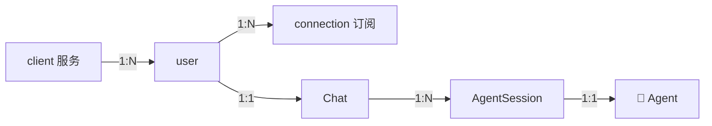
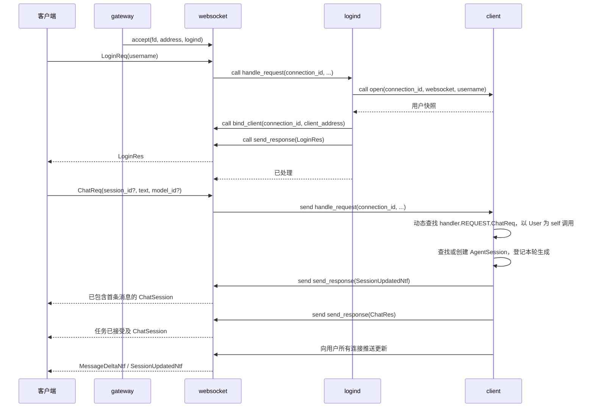

# Agent WebSocket 网关

本文说明运行机制与接口。环境、启动、测试和热修操作见[开发指南](../DEVELOPMENT.md)，
参数、可用值与部署边界见[配置说明](../CONFIGURATION.md)。

## 边界

网关通过 WebSocket 提供接口。模型对话、会话历史、模型配置和 API Key 位于服务端，
以 `user` 为所有者，在服务器重启前保留。用户名识别不提供密码认证，数据暂不落盘。
连接断开不删除会话或停止生成。新 Flutter 客户端尚未接入该接口，当前只提供工作区和设置。
用户名区分大小写，长度为 1–32 个 Unicode 字符。

## 术语与职责

| 名称           | 含义                                                   |
| -------------- | ------------------------------------------------------ |
| `client`       | 承载客户端业务的 Skynet 服务，一个实例可以管理多条连接 |
| `connection`   | 单条网络连接及用户订阅                                 |
| `Chat`         | 用户聊天模块，管理会话集合、请求编排与通知             |
| `AgentSession` | 单个会话，保存展示消息、模型选择与生成任务             |
| `ChatSession`  | 单会话协议包装，包含会话状态及模型 ID                  |
| `Agent`        | 模型调用与历史管理对象，由 `agent.agent` 导出          |
| `user`         | 用户身份、会话集合和后台任务的所有者                   |



服务池实例数表示承载容量；连接数、用户数与智能体数分别描述。每个会话持有一个 Agent。
`config.agent`、`agent_gateway`、`skynet.agent.v1` 和 `/agent` 继续用于智能体业务配置或协议命名。
client 服务初始化时加载共享提示词模板。登录只创建用户及 Chat 模块；收到没有 `session_id` 的
首条 `ChatReq` 后，才创建 AgentSession、工作目录和 Agent，并立即开始该轮生成。
模板在创建 Agent 时与工具、权限和工作目录配置一起传入。
基础行为、运行时环境与项目规则分别组装，详见 [Agent 提示词](PROMPTS.md)。

## 服务生命周期

`main` 是进程的生命周期所有者，持有共享 Protobuf schema 和服务地址列表。它按依赖顺序创建、
命名和初始化服务，最后开放网关监听；启动失败则回收已创建服务。本机控制台在业务服务启动前开放，
启动卡住时也可显式强制关闭。关闭时先停止热修监听并等待当前批次结束，再停止接入、依次回收
WebSocket、登录和 client 服务，等待在途命令、连接读循环和后台生成退出后统一结束进程。
启动和关闭均无超时，正常关闭保留服务 VM 至进程结束。清理成功退出 0，清理失败退出 1；
显式强制关闭跳过清理并退出 1。进程重启由外部管理器负责。

| 目录 / 服务                                     | 职责                                                        |
| ----------------------------------------------- | ----------------------------------------------------------- |
| `base/service.lua`                              | 命令白名单、上下文、初始化、状态、关闭、异常边界、热修注册  |
| `service/init.lua`                              | 根据 loader 提供的服务名加载业务主体                        |
| `main.lua`                                      | 业务 schema、服务数量、依赖顺序和初始化参数                 |
| `base/node.lua` / `main`                        | 公共初始化、服务登记、启动失败回收、状态汇总、进程关闭      |
| `base/rpc.lua`                                  | 固定 Lua 协议、有超时与无超时调用、状态码、完整多返回值     |
| `helper/`                                       | Protobuf 加载与接入、服务池轮询与固定路由、开发渠道热修监听 |
| `service/gateway/gateway.lua` / `gateway`       | 单例监听和新连接分发                                        |
| `service/websocket/websocket.lua` / `websocket` | 连接生命周期、编解码、协议守卫、写队列和消息路由            |
| `service/logind/logind.lua` / `logind`          | 按用户名固定路由、绑定、登录响应、失败关闭                  |
| `service/client/client.lua` / `client`          | 用户集合、连接路由和更新推送                                |
| `user.lua`、`user/handler.lua`                  | 用户身份、快照及用户请求                                    |
| `user/mods/chat/`                               | Chat 业务模块及聊天请求 handler                             |
| `agent_session.lua`、`agent/`                   | 单会话生命周期、模型对话与历史提交                          |

`src/service/init.lua` 是公共业务入口，统一调用 `service.start(SERVICE_NAME)`。
独立脚本和 Skynet 内置服务优先于公共入口。`src/service/<name>/<name>.lua` 返回稳定类表，
使用服务名作为唯一模块名，例如 `require("gateway")`。
`src/lualib` 保存服务创建的对象与公共模块。各节点的 main 通过 `node.init(callback)` 定制业务启动，
回调接收节点实例；`node` 先完成公共初始化，再执行回调，最后进入就绪状态。
`node` 复用服务基础层的初始化与命令分发，统一管理进程生命周期，业务服务清单由 main 决定。
节点实例的 `launch(name, count, params, registered_name)` 默认按服务名和编号注册；
单实例可指定注册名，网关的 `.gateway` 由 main 显式传入。
基础目录加入搜索路径后，以 `class`、`rpc`、`service` 等短名加载模块。
Skynet 每个服务 VM 和 Busted 都先执行统一预加载脚本，将 `luaext.table` 的复制方法扩展到标准库，
业务代码直接调用 `table.copy`、`table.deep_copy`。
业务类的 `commands` 把公开命令映射到方法名，执行时动态查找方法；`ctor` 和私有方法不会直接暴露。
方法第一参是 `{source, session}` 上下文，后面是业务参数。基础层只对同步调用发送返回值，
返回格式为 `状态码, 业务结果...`；Lua 异常会被记录并转换为 `call_fail`。

初始化只能执行一次。服务就绪前拒绝业务命令；初始化期间仅放行 `initializing_commands` 显式登记的
命令，main 只登记 `force_shutdown`。关闭由初始化所有者发起并保持幂等。
`close` 成功表示清理完成，重复调用等待同一次结果。关闭期间拒绝新业务，仅允许
`closing_commands` 显式登记的收尾命令，例如回收迟到的接入 fd 和断线清理。
在途命令异常也会释放计数，client 服务的独立请求集合继续跟踪已断开连接的后台生成。

关服与用户取消都会主动关闭模型和权限判断响应流，并终止当前轮涉及的命令，等待生成协程收尾。
工具调用与结果属于会话历史；副作用发生后失败或取消不会丢弃执行事实，重试从检查点继续。
会话文件独立保存在服务端配置的工作根目录，服务器重启清空聊天内存但不自动删除文件。
交互式进程由会话执行器持有，跨轮次保留并受到执行期限限制；关服同时回收所有后台进程。
底层 HTTP 在连接建立及响应头返回前没有可用流句柄，此阶段先标记取消，取得流后立即释放；
模型请求超时仍生效，关服等待不另设截止时间。请求上下文通过稳定 Client 类传给 HTTP 兼容层，
各请求互不串扰。
基础层不对整个服务加串行锁，因为同一服务中的其他连接及跨服务回调必须继续运行。
长期对象的状态保存在实例中，方法位于模块导出的稳定类表，长期回调通过 `self:method()` 查找实现。
结构、接口、schema 和配置变化通过重启发布；后续兼容的缺陷修复才使用热修。
已进入执行的方法继续运行旧字节码，新方法调用使用更新后的实现；服务、对象和数据不会重建。
服务主体也通过稳定模块表热修，例如 `dbgcmd .gateway HOTFIX gateway`。
`node` 导出稳定的 `Node` 类表，公共运行期方法的缺陷修复可使用 `dbgcmd .main HOTFIX node`。
节点启动回调只执行一次，不保存在节点实例中；业务编排与公共启动流程的调整通过重启生效。
`develop` 渠道由 node 在业务服务启动完成后创建 `helper.hotfix_watch` 并建立源码基线，
在节点内协程轮询文件内容，连续保存稳定后串行发起批次。目标是 `.main` 与全部登记且已就绪的业务实例，
运行期新建实例加入后续批次。其他渠道不自动监听。
监听同时覆盖库文件与服务主体，基础目录文件映射为短模块名；排除主入口、公共服务入口、
热修器、监听器自身、预加载脚本和标准库扩展。这些启动代码以及新增、删除文件的变更通过重启生效。
节点先合并本次变更和失败实例积压的模块，对扫描到的源码内容进行编译，不执行候选函数。
任一文件语法错误都阻止整批分发，保留全部待更新模块供后续保存时重试。
通过预检查后，每个 VM 独立执行模块、校验并提交整批方法替换，返回 `updated` 和 `skipped` 模块列表；
某实例失败或响应超时，其完整待更新模块集保留至后续源码变更时合并重试，其他实例仍可完成更新。
服务不单独记录热修日志。节点根据实际更新结果，将模块映射为文件路径、去重排序，统一记录一次；
失败或部分成功也只输出一次汇总，全部跳过时不输出成功日志。
各 VM 的更新结果独立，不保证跨 VM 同时生效。
节点关闭先停止监听并等待在途批次结束，之后再清理业务服务。

内部调用使用 `rpc.call`、`call_no_timeout` 和 `send`。`call` 有默认超时，`call_no_timeout`
用于无超时等待服务初始化和清理完成。RPC 不自动重试：超时表示调用方停止等待，远端仍可能完成。
`send` 成功仅表示消息已交给 Skynet，不能当作远端执行确认。

控制台通过 `.main` 查询状态或发起关闭，操作入口见[服务管理](../DEVELOPMENT.md#服务管理)。
工作服务使用 `.client_1`、`.logind_1`、`.websocket_1` 等注册名，
网关使用 `.gateway`。状态查询并行收集服务状态，失联服务显示 `unavailable`。

## 连接与内部消息



WebSocket 只按连接是否绑定 client 服务选择路由。未绑定时同步等待 logind，暂停当前连接的读取；
其他连接仍可并发处理，logind 对 WebSocket 的绑定和写入回调也能执行。绑定后异步转发给 client 服务。
`logind` 不保存连接级登录状态，也不参与登录后的转发。

登录严格按 `client.open → websocket.bind_client → websocket.send_response(LoginRes)` 编排。
绑定先于成功响应，客户端收到成功响应后可以立即发送业务消息。失败时先同步写响应，再关闭连接；
绑定前失败由 logind 清理该连接订阅，绑定后断线或写入失败由 WebSocket 通知 client 服务。
调用超时或处理结果不是 `true` 时，WebSocket 以 1011 关闭连接。

每次接入生成独立 `connection_id`，服务之间用该标识操作连接，fd 只用于本地 socket。
迟到回调、超时回调和写队列执行前都检查连接对象身份，避免 fd 复用时影响新连接。
连接移除与 client 服务断线通知至多发生一次。登录超时从接入开始计时，覆盖未完成握手的连接。

WebSocket 提供以下通用命令，第一参均为基础层上下文：

- `bind_client(connection_id, client_address)`：绑定存活连接，拒绝覆盖其他 client 服务。
- `send_response(connection_id, message_id, name, args)`：编码并串行写入；写完返回 `true`。
- `close_connection(connection_id, code, reason)`：移除连接、通知 client 服务并关闭；重复操作无副作用。

WebSocket 入口校验 protobuf 消息存在且属于 `Req` 请求方向。
client 在初始化时通过 `package.searchpath("user.handler", package.path)` 定位 `user` 目录，
固定接入根 `user.handler`，并按目录名排序扫描 `mods` 的第一层子目录。
只有存在 `handler.lua` 的子目录才加载为 `user.mods.<name>.handler`，不递归扫描。
目录定位或扫描、`require`、模块返回值及 `REQUEST` 类型校验、请求重名检查任一步失败都会使服务启动失败。
全部 handler 在局部列表中加载和校验完成后，才将稳定 `REQUEST` 表的引用保存到 `self.request_handlers`，
每个 client 实例只在初始化时发现一次模块。

请求到达时，client 先以 WebSocket 的消息来源地址校验连接归属，再从已保存的 `REQUEST` 表中
按协议短消息名动态查找同名函数，以 User 实例作为 `self` 调用；请求期间不扫描目录或读盘，
不把处理函数复制到 User 类或其他分发表。新增模块通过重启接入，已有 handler 的兼容方法体修复继续支持原位热修。
`UserSnapshotReq` 由 `user/handler.lua` 处理；`ChatReq`、`MessageCancelReq`、`SessionModelSetReq`
由 `user/mods/chat/handler.lua` 处理并通过 `self.chat` 委托同目录的 `chat.lua`。
命名与分发规则见[隐式约定](../../隐式约定.md)。
未知业务请求（包括重复登录）以 1008 关闭，处理异常以 1011 关闭。

## 配置与传输

渠道加载、监听地址、服务实例数、模型与工具参数统一见[配置说明](../CONFIGURATION.md)。
模型请求使用从发送到流结束的总截止时间，包含停滞流；超时后关闭
供应商连接并释放该会话的本轮占用。客户端发送命令只等待接受确认，任务通过推送跟踪。

`helper.protobuf.load` 只由 main 执行。消费者初始化时 `attach` 共享只读 schema，再由各自 VM 中的
`network.protocol` 对象建立本地类型映射。require 顶层不进行文件读取或切换 Protobuf 状态。
main 在整个进程生命周期内存活，不提前释放 schema。

### Protobuf 编解码

`helper.protobuf.load(schema_directory)` 加载目录第一层的全部 `.proto`，文件按名称排序，
通过标准 import 关系一次加载。存在 `pb.bytes` 时只加载该预编译 FileDescriptorSet，
不再扫描或校验 proto；预编译需带 `--include_imports`，多个 proto 仍生成一个文件。

业务服务在初始化阶段调用 `attach()`，随后按完整消息类型名编解码，例如：

```lua
local protobuf = require("helper.protobuf")

-- main 已完成唯一 schema 的加载，当前服务接入只读 schema。
protobuf.attach()

local data = protobuf.encode("skynet.agent.v1.LoginReq", {
    username = "example",
})
local message = protobuf.decode("skynet.agent.v1.LoginReq", data)
```

helper 失败时抛出 Lua error，需要捕获时由调用方使用 `pcall`。`network.protocol` 独立管理
9 字节帧及类型哈希，每个 WebSocket 服务在自身 VM 中初始化协议对象。
schema、helper 公开接口或 `pb.so` 变化后必须重启；共享 schema 的持有者不能提前退出。

## 外部消息格式

共享协议位于 `common/proto`，服务端与独立 Lua 网络探针直接加载同一 schema。
固定二进制向量和真实网络检查入口见[开发指南](../DEVELOPMENT.md#测试与验收)。

每帧是 `压缩标志 uint8 | 消息 ID uint32 | 类型哈希 uint32 | Protobuf args`，固定头为 9 字节，
多字节整数使用网络字节序。类型哈希按完整 Protobuf 消息名计算 FNV-1a 32 位哈希。
WebSocket 负责消息边界、长度和分片重组，业务层不再增加长度字段。

请求消息 ID 从 1 严格递增，达到 `2^32 - 1` 后关闭连接，服务端忽略已处理 ID。
普通响应复用请求 ID；`Ntf` 主动推送使用 ID 0，不进入请求的 pending 表。
`ret` 与 `common/enum/error_code.lua` 一致，1 为成功。错误详情与供应商堆栈只记录在服务器。

| 请求                                                   | 成功内容                           |
| ------------------------------------------------------ | ---------------------------------- |
| `LoginReq(username)`                                   | 用户身份和所有会话的完整快照       |
| `UserSnapshotReq`                                      | 最新用户快照，用于重新建立同步基线 |
| `ChatReq(session_id?, text, retry_run_id?, model_id?)` | 接受确认和 `ChatSession`           |
| `MessageCancelReq(session_id, run_id)`                 | 取消已确认，任务退出后再推送终态   |
| `SessionModelSetReq(session_id, model_id)`             | 更新后的 `ChatSession`             |

`UserSnapshot.chat_sessions` 是 `ChatSession` 列表，允许为空。每项的 `session` 为 `SessionState`，
包含会话身份、标题、消息、revision 和运行状态；`model_id`、`permission_model_id` 为该会话的实际模型 ID。
快照的 `models` 提供公开模型清单，`default_model_id` 用于新草稿；快照中的 `permission_model_id`
为空时表示权限模型跟随会话选择，否则使用指定模型。

`ChatReq.session_id` 缺省或空串时，先校验文本、模型和重试参数，再创建会话并发送首条消息。
无会话 ID 不能重试；非空但不存在的 ID 返回失败，不创建会话。`model_id` 仅在首次创建时生效。
`ChatRes`、`SessionModelSetRes` 与 `SessionUpdatedNtf` 统一通过 `chat_session` 返回完整包装。
`SessionUpdatedNtf` 在开始生成、模型切换、取消请求和最终完成时携带完整会话包装；
`MessageDeltaNtf` 携带会话、任务、消息 ID、增量和递增会话版本。
快照包含消息状态、部分回答和活动任务。消息状态分为生成中、完成、停止和失败。
时间为毫秒时间戳，业务 ID 为不透明字符串；`run_id` 跨连接稳定，与线路请求编号分离。

只接受二进制帧和 `Req` 方向消息。文本帧以 1003 关闭，损坏数据、未知哈希、非零压缩标志或消息 ID 0
以 1007 关闭，错误消息方向以 1008 关闭。未绑定时只接受 `LoginReq`，其他业务请求先返回登录错误，
再以 1008 关闭。入站消息上限为 256 KiB；附件应使用独立 HTTP 数据通道。

## 客户端请求与取消

新客户端采用 Flutter，运行时与表现的所有权、Actor 消息及订阅生命周期见
[客户端运行时](CLIENT_RUNTIME.md)。当前 Chat 为空白布局应用，尚未建立业务连接。
连接、身份、pending 请求与会话缓存将在真实业务接入时由宿主持有，页面重建只替换订阅，
不关闭连接或重放业务命令；此契约须通过真实连接测试验收。

服务端请求按线路消息编号配对，业务 run_id 跨连接稳定。通知可以先于请求响应到达，
客户端接入时须按真实会话与任务编号合并，不按文本猜测请求归属。
会话快照包含版本、部分回答和任务状态；增量出现版本缺口时须重新获取完整快照。

每个会话最多一个生成，不同会话可以并发。生成任务由用户持有，全部连接离线后仍继续执行。
停止按会话和任务 ID 定位，确认不表示资源已释放，任务退出后广播停止终态。
取消已结束任务幂等成功，不存在的会话返回失败；服务关闭时取消任务并等待上游资源释放。

历史保留全部轮次，模型上下文保留已完成响应和已执行工具事实，未完成思考保存在消息记录中。
最新失败轮次支持原位重试，保留用户和助手消息 ID，为新一轮生成分配新 run_id；
后续已有新消息时旧失败轮次不能重试。用户数据保留在服务端进程内存，暂不持久化。

## 安全与验证

控制台仅在回环地址监听。WebSocket 路径在握手阶段校验，模型密钥不进入客户端。
当前没有身份认证，非回环监听限于受控网络；对公网发布前需要认证、授权、限流和连接配额。
新客户端尚未接入本机执行；WSS 证书配置由反向代理管理。

测试入口、真实模型凭据和产物位置见[测试与验收](../DEVELOPMENT.md#测试与验收)，
验收层级以[编码与协作规范](../../编码与协作规范.md#测试用例)为准。

## 工具执行与权限

`agent/` 统一保存 Agent、模型封装、工具、工作区、沙盒和权限代码。
`permission/rules.lua` 只快速阻止，`permission/llm_judge.lua` 独立判断每次通过的动作，
判断模型与主模型分别持有客户端，请求超时互不修改。输入或终端输出中的指令不能修改权限策略。
判断结果只对应本次动作和实际权限；失败、格式无效或信息不足时拒绝执行，不产生人工审批请求。

`exec_command` 启动 bash，`write_stdin` 继续访问所属会话的执行进程，`apply_patch` 处理文本补丁。
`common/native/agent_runtime/` 是服务端使用的公共 C 核心，统一补丁、文件访问、沙盒、进程与 PTY。
服务端 `lualib-src/process.c`、`filesystem.c` 只做 Lua 绑定，描述符接入 Skynet 调度。
Flutter 客户端当前未绑定该核心，后续本机执行可通过 FFI 复用 C ABI。`agent_worker` 在沙盒子进程执行补丁，私有临时输入随任务回收；
`process_launcher` 监督进程组，在控制连接关闭时终止子进程。C 变更需重新构建和重启。

会话 `execution_target` 为空时使用云端工作区，否则路由到指定桌面和工作区绑定。
桌面通过 `DesktopRegisterReq` 登记在线状态、远程开关和本次授权标识；只有目标桌面连接可以设置目录。
`SessionExecutionSetReq` 切换目标，保留历史并追加环境变更，不复制文件；执行中和后台进程未退出时拒绝切换。
首发草稿可通过 `ChatReq.execution_target` 提交目标。项目规则由实际执行端读取。

云端在准备动作后执行规则及独立模型判断，再通过 `ExecutionActionNtf` 定向下发工具操作，
桌面用 `ExecutionResultReq` 回传结构化结果。工作区从本机绑定查找，不接受远程传入任意路径；
执行时复查已准备的动作、参数、实际目录和授权标识。调用 ID 去重，断线不自动重放。
关闭远程撤销旧授权、停止远程来源进程；控制与状态回收仍可完成，本机来源进程继续。
桌面断线会终止其进程；服务器以结果未确认结束任务，重连恢复设备状态。
当前沿用用户名识别，不增加配对或账号认证；远程开关按用户名和设备持久保存。

macOS 使用 Seatbelt，Linux 使用 bubblewrap，默认只写本会话目录且允许联网。
沙盒外执行必须明确指定权限并经过判断，运行账号权限不变；隔离能力不可用时不自动降级。
文件写入使用目录句柄逐级检查、拒绝符号链接并原子替换单个文件；多文件操作失败时报告已完成的部分。

`ChatMessage.tool_calls` 保存工具记录，`ToolUpdatedNtf` 更新单条记录并推进会话 revision。
工具更新可能来自已结束回答的后台进程，因此按消息和工具 ID 定位，不依赖当前生成任务。
Web 与原生核心均检查版本连续性，出现缺口获取完整快照，重复或迟到通知不覆盖新状态。

## 会话模型与思考流

模型清单由 config 提供；登录和用户快照只包含公开模型描述。`SessionModelSetReq/Res` 按会话设置模型，
`ChatSession` 包装同时返回当前模型和实际权限模型 ID。切换不取消正在进行的模型请求，后续请求获取最新配置快照。
`agent.llm.base` 统一管理模型配置、客户端生命周期、流式响应、思考通知与用量日志。
主模型与权限模型各持有独立实例；SDK 适配和单次 HTTP 请求的取消状态由同模块的
`Base.Client`、`Base.Request` 管理，类表从模块导出以支持原位热修。`agent.Run` 管理整轮任务。

助手消息与工具记录分别保存主模型和权限模型的思考块。`ReasoningDeltaNtf.block.text` 为新增文本，
终态通知可携带空文本；客户端按块身份追加，沿用会话 revision 去重和缺口恢复。
完整快照包含累计内容；取消和失败保留部分思考，重试建立新块并保留原尝试。
模型原始输出用于上下文续接，工具权限思考不混入主模型工具结果。

公共提示和工具定义保持稳定，会话环境位于公共前缀之后，历史与工具结果只追加。
根项目规则在新用户任务开始时读取，变化时追加替换或失效通知，本轮调用与失败重试共用规则快照。
应用、项目规则和直接用户输入的来源保存在内部历史中，发送供应商请求前去除内部来源字段。
权限模型使用独立提示词，按固定字段顺序提供带来源的历史证据，当前动作及原始参数置于末尾；
主模型的 system/developer 内容和项目授权声明不会作为权限模型的高级指令重放，不对历史做 JSON 排序。
HTTP 直接转发 SDK 编码的请求体，JSON 编解码直接复用 `cjson`。
模型用量按主模型与权限模型分别记录；命中以供应商实际返回的 cached tokens 为准。
