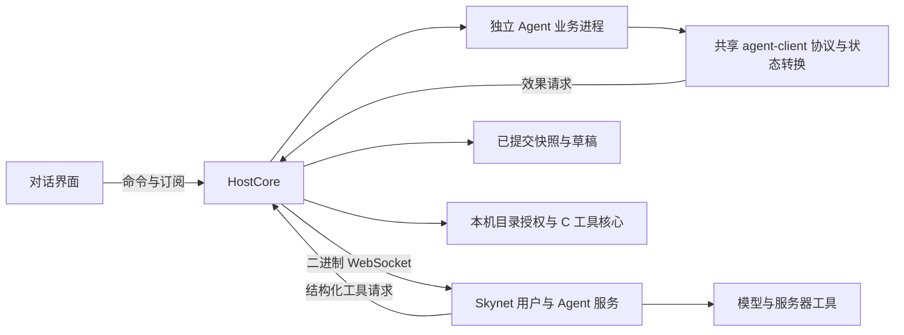

# Agent 客户端

Agent 子应用接入现有二进制 protobuf 网关，提供多会话、模型选择、流式回答、思考与工具记录、
取消和失败重试。任务可在服务器工作目录或用户授权的 macOS 本地项目中执行。
内置应用开发、应用动作发现与安装流程尚未由 Agent 对话驱动。

## 分层

- `builtins/agent/src/view.tsx` 负责表现和临时编辑输入，草稿变更立即提交所属业务状态。
- `packages/agent-client` 包含环境无关的协议、会话状态和命令转换；选择器与类型可单独供 UI 引用。
- 客户端生成器和原生测试均从 `common/proto/schema.proto` 加载登录和 Agent 协议。
  `pnpm protocol:generate` 生成描述，`pnpm protocol:check` 检测漂移。
- 原生资源代理持有连接与重连计时器，工作区与子应用通过该代理联网。
- iPhone/iPad 复用同一业务协议，以进程内 JSC VM 运行可信内置 Agent；
  远程操作已有桌面项目或服务器目录，不注册执行器和获取手机开发目录。

## 连接

先启动服务端，在宿主登录页填写完整 WebSocket 地址和用户名。打开 Agent 时，宿主传入已确认的身份；
Agent 建立自己的业务连接，并核对服务端返回的用户 ID 和用户名。
服务器按用户名识别用户；这不是密码认证，不应当直接作为公开互联网登录方案。
模型 API Key 只配置在服务端。

普通子应用的网络来源由 manifest 的 `networkOrigins` 明确授权。
宿主首次登录新远程服务器时显示服务器地址与数据用途，用户确认后由宿主持久保存，
无需修改清单或重新构建。远程连接使用 `wss`，仅本机回环允许 `ws`。
授权按协议、主机与端口精确匹配；不能用相似域名、重定向或 URL 凭据绕过。

配置与草稿由客户端保存，服务端是会话与任务的权威来源。更换服务器或用户名时清除当前用户缓存。
服务器当前把会话保存在内存，重启服务器会清空会话；客户端缓存不能恢复服务器已丢失的任务。

## 本地工作目录

在输入区的工作目录选择器中选择服务器目录，或通过系统文件选择器授权本机项目。
已有会话可在没有活动轮次和后台进程时切换目标；文件不会随目标切换自动复制。
宿主持久保存本机设备 ID、目录书签与授权来源；会话保存结构化执行目标。
登录后先用 `AgentSnapshotReq` 取得该用户的 Agent 快照，再注册设备并释放执行请求。
服务下线时原窗口显示下线状态，继续交付在途工具清理回执。上线通知到达后，在同一登录连接获取空会话快照并重新登记已授权桌面。
网络断开、业务进程崩溃或宿主退出时结束本地进程，
重连生成新的执行授权，不重放结果不明的操作。界面重载与返回桌面保留连接和进程。

`AgentServices` 在独立串行队列上管理工具进程，复用公共 C 核心与受监督启动器；
使用非阻塞 I/O 和计时器，保持 HostCore 与工作区、子应用页面可响应。
支持项目规则读取、命令、终端输入、补丁、后台状态与取消。执行请求校验授权代次、目录、
会话、run 和请求编号，重复执行编号不重放；跨会话进程访问和目录越界被拒绝。
模型与权限模型仍在服务器运行；项目规则、命令输出与相关文件内容会传给所连接的服务器。
这不是完全离线 Agent，也不会自动上传整个本机目录。

当前本地工具只允许所选项目内的沙盒执行，不提供 `require_escalated` 沙盒外执行；
远程控制本机默认关闭，可在连接设置中启用。关闭后停止远程进程并更新设备可用状态。
本机 Agent 必须在线；手机或 Web 可通过服务器向已开启远程执行的桌面会话发指令，
其原生客户端接入状态仍以平台清单为准。

## 状态与恢复

每条连接独立递增请求编号，通过响应编号和类型匹配请求。任务另有会话 ID 与 run ID，
线路请求结束不等于模型任务结束。服务端通知可以早于响应：
登录期间缓存通知，获得完整基线后合并；完整会话按 revision 更新，增量只接受连续版本。
重复与迟到消息被忽略，发现缺口重新拉取 Agent 快照。

连接中断后按有上限的退避重连，登录并恢复服务器快照。超时或业务进程重启时，不自动重发聊天、
重试或取消命令；无法确认的发送保留草稿并提示先检查恢复的会话。
界面重载、返回桌面和查看后台均不重启业务进程，不重新登录，也不停止服务器任务。
关闭内部 Agent 或退出宿主会结束本地连接；服务器任务仍按服务端生命周期运行。
iOS 系统后台关闭本地 VM 与连接，回前台恢复服务器快照；这与内部应用后台保活不同。
手机首次使用桌面项目时，应先在该桌面创建并授权项目会话，再由手机恢复并继续指令。

取消响应只表示请求已受理，等待服务端推送终态。重试仅面向最新且可重试的失败轮次，
由服务端保留原消息身份并创建新的 run。切换会话与界面重载不能让迟到响应清空另一份草稿或改变选择。
取消和重试命令绑定界面显示的具体 run，迟到点击不能取消或重试后来的轮次。
模型轮次结束后，服务器后台进程仍可产生工具更新；这些更新按所属消息和 run 合并，不把会话误判为缺失。
模型选择按会话串行且幂等；同一选择重复到达不新建请求或显示错误横幅，也不重设历史阅读位置。

## 验证

逻辑测试使用公共 Lua/C 协议向量，并覆盖通知先到、版本缺口、取消确认、超时与迟到结果。
原生集成使用真实 JavaScriptCore、二进制 WebSocket 和 WebKit，
验证表现重建后的连接身份、最终回答、草稿与窄布局。
真实业务验收通过对应平台 App 连接真实服务器和模型；确定性假模型不能替代这一层。
