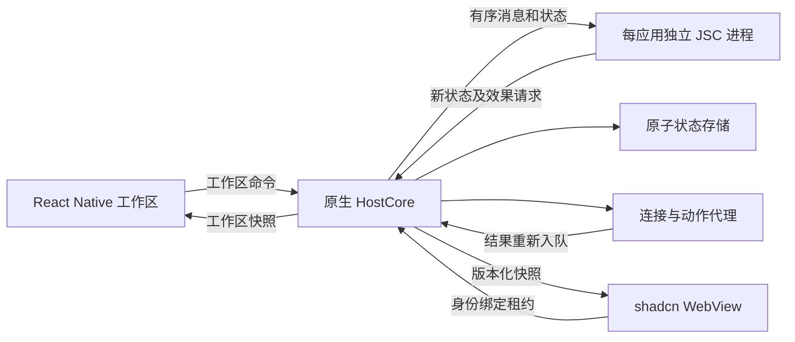

# 客户端运行时

客户端由 React Native macOS 工作区、独立 WebView 表现和每个应用独立的 JavaScriptCore 业务进程组成。
当前内置设置与空白 Agent；聊天、Agent 开发应用和远程分发尚未接入。首版只支持 macOS。
UI 规格见[客户端设计规范](../design/CLIENT_DESIGN.md)。

## 所有权与数据流

原生 AppDelegate 创建并持有 HostCore。React Native 只订阅工作区，WebView 只订阅所属应用；
界面持有租约，不能释放业务进程、存储或连接。纯 TypeScript runtime 接受状态与消息，
同步返回新状态、结果和效果请求。状态与资源不保存在 React 组件中。

HostCore 的可变状态全部归属于单一串行队列。每个应用有自己的 FIFO 邮箱和运行时代次；
不同应用可以在不同进程同时计算，同一应用一次只执行一条状态转换。UI 不创建业务 worker。
原生资源异步完成后回到同一队列，校验应用代次与任务身份，禁止直接修改状态。

每次状态转换先校验动作输出与效果，再原子写入应用状态，成功后发布快照并开始效果。
存储失败拒绝提交，保留此前状态。异步完成仍通过同步 reducer 处理，不能在 reducer 内等待网络或调用其他应用。
一个慢应用不会阻塞另一个应用的业务进程。HostCore 不执行子应用 JavaScript。

## 生命周期

| 操作 | 业务与资源 | 表现 |
| --- | --- | --- |
| 返回桌面、后台、分屏 | 保留进程、任务与连接 | 按布局创建或销毁视图 |
| 重载 React Native 或子应用界面 | 原生宿主、业务进程与连接保留 | 旧租约失效，重新订阅快照 |
| 关闭内部应用 | 结束进程，关闭资源，保留已提交数据 | 释放内容 |
| 运行时崩溃或超限 | 终止所属进程和连接，拒绝在途命令 | 显示所属应用故障与重启入口 |
| 安装更新 | 先验证和探测，再替换包；关闭旧代次 | 按版本重新创建界面 |
| 移除应用 | 关闭运行时，删除包与权限，保留数据 | 从桌面与工作区移除 |
| 退出或重新启动宿主 | 退出时关闭子进程；重启加载已提交数据 | 恢复偏好与工作区 |

租约身份由原生绑定，子应用不能在 JSON 中冒充另一个应用。detach 后旧租约不能发新命令；
已经接收的命令仍由业务所有者完成，响应不会投递给失效界面。重新订阅不重放命令。
快照携带运行时代次和提交序号，SDK 拒绝过期状态。

每次 Web 文档载入前，宿主注入所属应用的最新快照和文档身份，首屏直接使用已保存状态与主题。
SDK 在首屏提交后发送 `view.ready`；可见文档额外等待绘制帧，后台文档不依赖可能暂停的帧回调。
原生校验当前文档身份后显示内容，旧文档的就绪信号不能揭开新文档。
揭开内容后通知原生无障碍布局变化，让辅助功能及时发现异步载入的 Web 控件。
界面载入超时显示重载入口，不重启业务或重放命令。

任务使用应用、代次、ID 和本次执行令牌定位。取消使令牌失效，迟到结果无法提交；
取消不能撤销已经发生的外部副作用。待处理 ID 与业务状态一起保存。进程重启后通过
`$interrupted` 通知应用，不自动重放任务；应用决定如何展示中断并由用户明确重试。

## 应用契约与协作

`client/packages/contracts` 定义 manifest、快照、命令、效果和动作。应用源码分为：

- `manifest.json`：稳定 ID、版本、最低宿主版本、状态版本、权限、精确网络来源和导出动作。
- `src/runtime.ts`：纯同步状态转换，可导出带输入、输出 schema 的动作。
- `src/view.tsx`：shadcn 表现，通过 SDK 订阅状态和请求命令。

当前支持 `socket.open`、`socket.send`、`socket.close` 和 `apps.call` 效果。
网络权限需要 manifest 声明并得到安装授权；仅允许精确 `wss` 来源及显式回环 `ws`。
连接由 ResourceBroker 持有，不因 WebView 卸载而关闭。

跨应用调用必须同时满足调用方声明、用户授权和目标动作存在。原生校验输入和输出，
返回值不符合 schema 时不提交目标状态。schema 使用封闭子集，未知关键字、无效类型及边界在安装时拒绝，
不静默忽略。对象必须禁止额外字段。宿主偏好和应用管理权限仅授予受信任内置设置。

Agent 未来通过相同的结构化动作发现、调用和组合应用，不通过模拟点击执行业务。
新增原生能力必须同步实现契约、宿主校验、资源清理和拒绝测试；仅新增 TypeScript 类型不算完成。

## 安装、存储与隔离

应用包是 `.skapp` 目录，包含 manifest、业务 JS 和 Web 静态资源，不支持原生扩展。
开发者使用 `client/tooling/create-app.mjs` 创建源码，再使用 `build-apps.mjs` 打包；
设置应用通过系统文件选择器和权限确认安装。包内文件使用摘要清单校验，拒绝链接、越界路径、
未登记文件、大小超限与不支持的宿主或状态版本。

安装在宿主管理目录中暂存、复验，再用独立进程加载当前持久状态探测。
只有探测成功才提交权限并原子替换目录；探测失败保留旧应用及数据。
此版本不执行状态格式迁移，所有包使用受支持的状态版本。数据保存在宿主 Application Support 中，
应用仅得到自己的 JSON 状态，不能直接读写文件或其他应用数据。

每个业务进程只有 JavaScriptCore 与受限 JSON 通道，不导出文件、网络和原生对象。
macOS 沙盒默认拒绝写入、联网与新建进程，仅允许启动与运行系统框架所需读取。
监督器限制消息、邮箱、任务、连接及运行应用数量，执行超时终止进程。
内存限制通过采样进程驻留内存后终止实现，是监测预算，不是操作系统硬配额。

WebView 使用独立临时数据存储、固定应用资源来源、CSP 与导航限制；网络和原生调用只能经过宿主。
WebKit 可能共享渲染进程，因此这里的每应用独立进程保证针对业务执行。
Web 表现可使用 React 错误边界恢复渲染错误；WebKit 退出时显示原生重载入口。

安装仅面向本机手动选择并信任的开发包。摘要证明文件完整性，不代表开发者身份；
签名分发、自动更新、App Store、公证和不受信任包市场尚未实现。
其他平台必须接入对应进程、权限、资源和安装适配器后单独验收。
Web worker 或错误边界不能描述成与 macOS 进程及沙盒相同的隔离等级。

## 检查与调试

`make client-check` 检查格式、类型、令牌、依赖边界、几何规则及原生集成。
`make client-test` 使用实际 JSC helper 和回环 WebSocket 检查串行状态、界面重订阅、
连接身份、超时、崩溃、内存、权限、更新、存储失败和取消后迟到结果。
安排前台测试时段后，`SKYNET_FOREGROUND_UI_TESTS=1 make client-e2e` 构建最新 macOS App，
执行 XCUITest 验证原生工作区和 WebView 交互。该测试会占用鼠标、键盘，不能作为后台 Computer Use。
这些检查不等于真实聊天和其他平台已验收。

原生错误写入统一日志并带应用身份；业务异常保留 JSC 错误，监督器报告超时、退出或内存原因。
排查时核对应用 ID、代次、提交序号和任务 ID，不记录凭据与聊天正文。
截图和测试证据统一写入忽略的 `client/test-artifacts/`，不维护像素基线。
