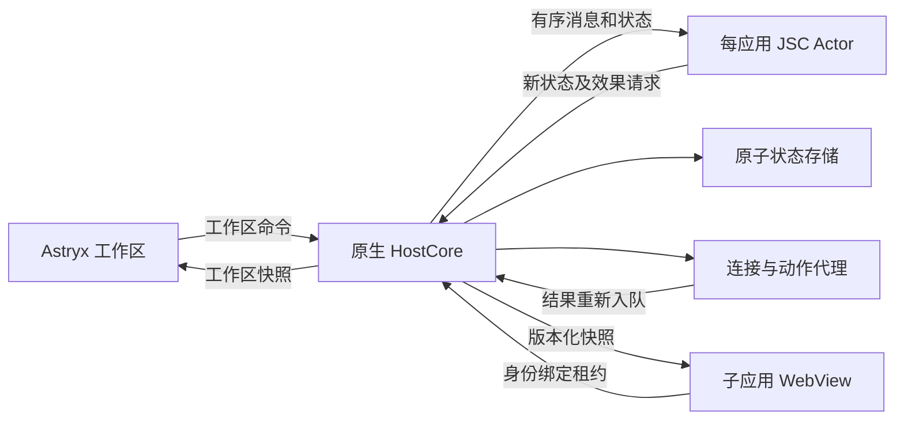

# 客户端运行时

客户端由 Astryx Web 工作区、受限子应用 WebView 和 JavaScriptCore 业务运行时组成。
macOS 每应用独立进程，iOS/iPadOS 每个可信内置应用独立 VM 与串行队列，属于进程内隔离。
当前内置设置与 Agent。Agent 已接入服务器会话、流式任务、模型选择、取消与失败重试；
已接入 macOS 本地项目执行器；移动端发送远程指令。Agent 生成并安装应用和远程分发尚未接入。
业务协议和恢复规则见 [Agent 客户端](CLIENT_AGENT.md)。
UI 规格见[客户端设计规范](../design/CLIENT_DESIGN.md)。
公共代码、能力边界和实际平台支持见[平台接入](CLIENT_PLATFORMS.md)。

工作区表现位于 `packages/workspace`，由平台入口注入原生视图与通信。
`packages/host-bridge` 只缓存快照并管理界面订阅，不依赖 React 或持有原生资源。
工作区状态转换由 `native/core` 的公共 C++ 实现，macOS 的 Swift 适配只转换数据；
持久化、Actor 与连接的所有权仍在 `native/apple` 的原生 HostCore 中。

## 所有权与数据流

原生 AppDelegate 创建并持有 HostCore。受信任的宿主页面订阅工作区，每个子应用页面只订阅所属应用。
界面持有租约，不能释放业务进程、存储或连接。纯 TypeScript runtime 接受状态与消息，
同步返回新状态、结果和效果请求。状态与资源不保存在 React 组件中。

HostCore 的可变状态全部归属于单一串行队列。每个应用有自己的 FIFO 邮箱和运行时代次；
不同应用可以在各自运行时同时计算，同一应用一次只执行一条状态转换。UI 不创建业务 worker。
原生资源异步完成后回到同一队列，校验应用代次与任务身份，禁止直接修改状态。

每次状态转换先校验动作输出与效果，再原子写入应用状态，成功后发布快照并开始效果。
存储失败拒绝提交，保留此前状态。异步完成仍通过同步 reducer 处理，不能在 reducer 内等待网络或调用其他应用。
一个慢应用不会占用另一个应用的串行执行队列。HostCore 的所有者队列不执行子应用 JavaScript。

## 生命周期

| 操作 | 业务与资源 | 表现 |
| --- | --- | --- |
| 返回桌面、后台、分屏 | 保留进程、任务与连接 | 保留已打开应用的表现缓存，改变可见性与容器矩形 |
| 内存压力 | 保留业务与资源 | 丢弃隐藏表现；再次进入重新订阅和载入 |
| 重载工作区或子应用界面 | 原生宿主、业务进程与连接保留 | 重载的页面重新订阅快照 |
| 关闭内部应用 | 结束进程，关闭资源，保留已提交数据 | 释放内容 |
| 运行时崩溃或超限 | 终止所属进程和连接，拒绝在途命令 | 显示所属应用故障与重启入口 |
| 安装更新 | 先验证和探测，再替换包；关闭旧代次 | 按版本重新创建界面 |
| 移除应用 | 关闭运行时，删除包与权限，保留数据 | 从桌面与工作区移除 |
| 退出或重新启动宿主 | 退出时关闭子进程；重启加载已提交数据 | 恢复偏好与工作区 |

上表的独立进程监督与动态包管理适用于 macOS。iOS 只运行随包交付的可信内置应用，
没有公开的任意 JS 线程强杀接口；超时只撤销逻辑权限并隔离该应用的重开入口，
不能保证阻止进程内的持续计算或内存分配。
进入整个 iOS App 的系统后台时关闭业务 VM 与连接，保留已提交状态和中断任务；
回前台重建之前运行的应用并恢复服务器快照，不自动重发聊天或工具。
内部返回桌面、后台列表或切换应用仍保留 VM 与连接。服务器或桌面拥有实际开发任务，
手机挂起不把它们迁到手机执行。iOS 不开放动态包安装、本地目录及工具执行能力。

租约身份由原生绑定，子应用不能在 JSON 中冒充另一个应用。detach 后旧租约不能发新命令；
已经接收的命令仍由业务所有者完成，响应不会投递给失效界面。重新订阅不重放命令。
快照携带运行时代次和提交序号，SDK 拒绝过期状态。

表现缓存以应用身份保持，隐藏时禁用输入、辅助功能和键盘焦点，不卸载原生 WebView。
共享工作区的稳定场景容器统一拥有矩形与显隐，平台动画位于容器内部。
平台容器将共享可见状态直接映射为原生 hidden，不另存显示规则；
透明度、输入和辅助功能标记与其保持一致，隐藏不会卸载 WebView。
缓存保留、场景激活与过渡动画分别管理，动画的完成或清理不能修改场景的最终可见性。
关闭、包版本变化、表现重载与内存压力才释放相应缓存；缓存不能拥有业务资源。
每次新 Web 文档载入前，宿主注入所属应用的最新快照和文档身份，首屏直接使用已保存状态与主题。
WebKit 与业务初始化并行，SDK 等待初始化状态提交后发送 `view.ready`；
可见文档额外等待绘制帧，后台文档不依赖可能暂停的帧回调。
原生校验当前文档身份后显示内容，旧文档的就绪信号不能揭开新文档。
揭开内容后通知原生无障碍布局变化，让辅助功能及时发现异步载入的 Web 控件。
界面载入超时显示重载入口，不重启业务或重放命令。

任务使用应用、代次、ID 和本次执行令牌定位。取消使令牌失效，迟到结果无法提交；
取消不能撤销已经发生的外部副作用。待处理 ID 与业务状态一起保存。进程重启后通过
`$interrupted` 通知应用，不自动重放任务；应用决定如何展示中断并由用户明确重试。

## 应用契约与协作

`client/packages/contracts` 定义 manifest、快照、命令、效果和动作。应用源码分为：

- `manifest.json`：稳定 ID、版本、最低宿主版本、状态版本、权限、精确网络来源和导出动作。
- `src/runtime.ts`：纯同步状态转换，可导出带输入、输出 schema 的动作。
- `src/view.tsx`：Web 界面，通过 SDK 订阅状态和请求命令。

当前支持 `socket.open`、`socket.send`、`socket.close`、`timer.wait` 和 `apps.call` 效果。
内置 Agent 独占 `agent.context`、`agent.execute` 及原生目录、服务器授权入口；
即使普通包声明相似权限，也不能获得这些能力。目录、设备与工具进程由原生宿主管理。
`socket.send` 在 `text` 与 base64 `data` 之间二选一，收包使用相同字段区分帧类型；
可以绑定 `connectionId` 拒绝旧连接发送。消息上限为 256 KiB。
`timer.wait` 由宿主执行，按应用和 key 管理，替换同 key 时旧任务收到失败；退出应用时清理。
计时范围和并发数量有硬限制，不能在 reducer 或 Web 页面持有业务重连计时器。
网络权限需要 manifest 声明并得到安装授权；仅允许精确 `wss` 来源及显式回环 `ws`。
内置 Agent 还可由用户在原生确认框中授权新服务器；额外来源仅对该内置应用生效。
连接由 ResourceBroker 持有，不因 WebView 卸载而关闭。
应用可定义同步 `start(state)`，在业务进程加载并处理上次中断后执行一次；
安装探测和界面订阅不会执行它。恢复连接等启动效果仍遵循先持久提交、后执行的规则。
运行时构建注入纯 JavaScript 的标准文本编解码实现，补足 JavaScriptCore 的环境差异；
不导出文件或网络对象。

跨应用调用必须同时满足调用方声明、用户授权和目标动作存在。原生校验输入和输出，
返回值不符合 schema 时不提交目标状态。schema 使用封闭子集，未知关键字、无效类型及边界在安装时拒绝，
不静默忽略。对象必须禁止额外字段。宿主偏好和应用管理权限仅授予受信任内置设置。

Agent 未来通过相同的结构化动作发现、调用和组合应用，不通过模拟点击执行业务。
新增原生能力必须同步实现契约、宿主校验、资源清理和拒绝测试；仅新增 TypeScript 类型不算完成。

## 安装、存储与隔离

应用包是 `.skapp` 目录，包含 manifest、业务 JS 和 Web 静态资源，不支持原生扩展。
开发者使用 `client/tooling/create-app.mjs` 创建源码，再使用 `build-apps.mjs` 打包；
设置应用通过系统文件选择器和权限确认安装。包内文件使用摘要清单校验，拒绝链接、越界路径、
未登记文件、大小超限与不支持的宿主或状态版本。

安装在宿主管理目录中暂存、复验，再用独立进程加载当前持久状态探测。
只有探测成功才提交权限并原子替换目录；探测失败保留旧应用及数据。
此版本不执行状态格式迁移，所有包使用受支持的状态版本。数据保存在宿主 Application Support 中，
应用仅得到自己的 JSON 状态，不能直接读写文件或其他应用数据。

每个业务进程只有 JavaScriptCore 与受限 JSON 通道，不导出文件、网络和原生对象。
macOS 沙盒默认拒绝写入、联网与新建进程，仅允许启动与运行系统框架所需读取。
监督器限制消息、邮箱、任务、连接及运行应用数量，执行超时终止进程。
内存限制通过采样进程驻留内存后终止实现，是监测预算，不是操作系统硬配额。

WebView 使用独立临时数据存储、固定应用资源来源、CSP 与导航限制；网络和原生调用只能经过宿主。
WebKit 可能共享渲染进程，因此这里的每应用独立进程保证针对业务执行。
Web 表现可使用 React 错误边界恢复渲染错误；WebKit 退出时显示原生重载入口。

安装仅面向本机手动选择并信任的开发包。摘要证明文件完整性，不代表开发者身份；
签名分发、自动更新、App Store、公证和不受信任包市场尚未实现。
其他平台必须接入对应进程、权限、资源和安装适配器后单独验收。
Web worker 或错误边界不能描述成与 macOS 进程及沙盒相同的隔离等级。

## 检查与调试

`make client-check` 检查格式、类型、令牌、依赖边界、几何规则及原生集成。
`make client-test` 使用实际 JSC helper 和回环 WebSocket 检查串行状态、界面重订阅、
连接身份、超时、崩溃、内存、权限、更新、存储失败和取消后迟到结果。
使用 Computer Use 在最新本地 macOS App 上验收原生工作区和 WebView 交互。
这些检查不等于真实聊天和其他平台已验收。

原生错误写入统一日志并带应用身份；业务异常保留 JSC 错误，监督器报告超时、退出或内存原因。
排查时核对应用 ID、代次、提交序号和任务 ID，不记录凭据与聊天正文。
截图和测试证据统一写入忽略的 `client/test-artifacts/`，不维护像素基线。

首屏性能以全新 WebView 测量，和保留界面的复开分别记录。`AppSurface startup` 按请求、
创建、开始导航、文档提交、加载完成与内容揭开记录累计耗时，以区分业务初始化、
WebKit 进程启动与页面执行。模拟器的辅助功能检查可能增加 WebKit 初始化成本；
需要用相同设备、相同构建做对照，并以真机 Release 结果决定是否预热或调整缓存。
不以关闭辅助功能、共享应用身份或使用私有 WebKit API 换取启动速度。
