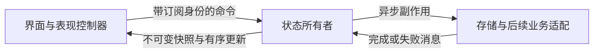

# 客户端运行时

客户端使用 Flutter，共享 Apple 视觉与交互，macOS App 是首个体验验收平台。
当前提供桌面、Dock、设置、空白 Chat、后台与分屏；聊天连接和工具执行尚未接入。
UI 规格见[Flutter Apple 设计规范](../design/APPLE_FLUTTER_DESIGN.md)。

## 所有权与数据流

组合根创建 `ClientRuntime`、存储实现与日志入口，初始化后交给 Flutter 宿主。
宿主持有工作区、设置导航、偏好和子应用状态；Widget 不拥有这些运行时的释放权。
领域模型是纯 Dart 数据，存储编解码在数据层，原生菜单和材质在平台层。
表现控制器将运行时快照转换为 Flutter 通知，焦点、动画、滚动和拖动预览由表现层持有。

每份业务状态只有一个所有者。Actor 通过 FIFO 消息队列处理命令，重入发送只追加到队尾。
状态转换同步生成完整的新状态，再发布快照；转换失败不提交部分状态。
转换中不等待网络、文件或其他 Actor 的结果，异步完成后重新投递消息。
订阅注册和初始快照在同一同步步骤完成，更新带递增提交序号。
表现通知可合并绘制，但不能丢弃业务命令。

## 生命周期

| 操作 | 运行时 | 表现 |
| --- | --- | --- |
| 返回桌面、后台、分屏 | 保留 | 保留当前导航，按布局显示 |
| 重新加载子应用界面 | 保留状态与已提交任务 | 销毁内容、重新订阅并恢复快照 |
| 销毁并重建整个 Flutter 界面树 | 注入的宿主仍保留 | 重新创建表现控制器 |
| 关闭内部应用 | 保留偏好与业务资源，重置应用导航 | 释放内容并使旧界面代次失效 |
| 请求退出宿主 | 停止接收命令，等待已提交偏好保存，释放资源 | 退出 |
| 重启整个程序或刷新整个 Web 页面 | 重新初始化 | 从持久偏好恢复 |

界面订阅是一份可失效的租约：detach 后停止更新，旧租约不能继续发送命令。
页面卸载只 detach，不能关闭 Actor。界面代次用于过滤旧回调和旧界面错误，
不充当业务任务编号；表现重建不能取消仍有效的业务操作。
未来连接、身份、请求和缓存由宿主持有，连接资源不能在页面的 initState/dispose 中创建或关闭。
重新订阅不重放发送命令，真实 WebSocket 接入后另行验证连接持续与消息接续。

## 故障与恢复

构建错误由 Flutter 错误控件入口找到所属子应用，显示统一错误反馈与“重新加载界面”。
子应用 callback 通过携带界面代次的入口执行，过期调用和过期错误不能影响新界面。
消息转换、订阅和副作用入口记录失败，订阅异常只使对应租约失效；宿主和其他子应用继续运行。
存储读写失败保留可用内存状态并展示具体反馈，后续保存成功后恢复。
全局错误入口保留 Flutter 原有异常报告，不通过吞掉错误制造成功结果。

恢复只重建表现，不自动重试具有副作用的操作。单进程隔离覆盖可恢复的 Dart 错误，
不保证原生崩溃、进程内存破坏或主 isolate 死循环后的继续运行。

## 并发与调试

Actor 是状态管理模型，不要求每个 Actor 独占 isolate。轻量状态转换与 UI 留在主 isolate；
网络、文件使用异步 I/O。当前没有需要迁出的重计算，不建立闲置 worker 或线程池。

接入真实重任务时遵循以下规则：

- 原生通过统一入口使用有界 worker isolate；输入和输出为明确的数据，不传 Widget、BuildContext、
  socket 或原生句柄，不允许后台任务直接修改 Actor 状态。
- Web 共用命令与结果语义。Flutter Web 的 compute 不提供后台并行；算法须可分块并让出事件循环。
  后续采用 Web Worker 时由执行适配承担，不改变业务状态的所有权。
- 任务有独立编号、所属应用与运行时代次；超时、取消请求、实际结束分别管理。
  Future.timeout 不会停止原操作，迟到结果必须被过滤，资源仍须释放。
- worker 错误与退出有明确处理；有副作用的任务不自动重放。
- 日志关联状态提交序号、任务编号、代次、耗时与堆栈，不记录凭据或聊天正文。
  时钟和外部适配可注入；使用可控完成顺序验证后发先至、取消后返回和退出竞争。

## 检查与验证

`make client-check` 检查 UI 规格、导入边界和全部 Flutter 单元/组件行为。
`make client-e2e` 验证真实 macOS 工作区交互、设置持久化、局部错误恢复与界面重建。
这不等于真实聊天、连接不断开或其他平台已经验收。
测试产物写入忽略的 `client/test-artifacts/`，截图不维护像素基线。
