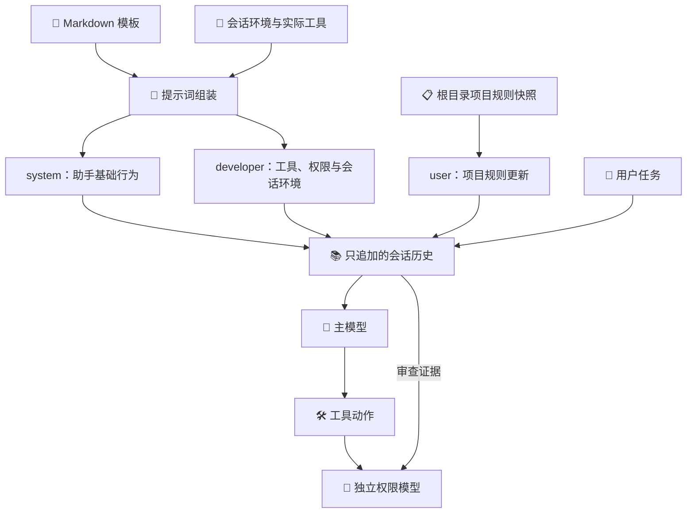

# Agent 提示词

提示词帮助 Agent 理解自己的职责、可用工具、会话环境和项目规则。主模型负责回答与完成任务，
独立权限模型负责判断具体工具动作；两者使用各自的提示词，项目文件不能替换权限判断策略。

## 文本与运行时事实

`agent.prompts` 负责加载文本和组装消息。Markdown 模板位于
`server/src/lualib/agent/prompts/templates/`，按基础行为、工具使用、权限说明和独立权限判断拆分。
基础行为适用于通用助手；工具与权限说明只在实际提供工具时加入。

每个 client 服务在初始化时调用 `Prompts.load_templates()`，将同一份模板交给它管理的 Agent。
模块加载本身不读取文件，模板变更通过重启服务生效。模板缺失、空白或不是有效 UTF-8 文本时，
初始化失败。

工作目录、操作系统、可用工具和执行限制来自实际执行目标，单独组装为会话环境消息。
本地或远程开发的根项目规则由目标桌面读取；切换目标只追加环境及规则失效/更新通知，不改写历史前缀。
工具参数以实际请求中的工具定义为准，模板不维护另一套参数 schema。

## 项目规则

Agent 在每次新用户任务开始时检查会话根目录，优先使用 `AGENTS.override.md`；仅在该文件不存在时
使用 `AGENTS.md`。空白 override 表示没有有效根规则，也会遮蔽同目录的 AGENTS.md。
自动加载不会向父目录或用户主目录查找，也不会递归扫描子目录。

根规则以带来源文件和作用目录的 user 消息提供。应用的 system、developer 指令和用户直接要求
优先于项目规则；更深层的规则在其目录内覆盖上层冲突规则。处理子目录任务时，Agent 通过现有工具
读取适用规则及规则要求阅读的文档。

`agent.project_instructions_max_bytes` 控制自动加载的根规则字节上限，取非负整数，`0` 关闭自动加载。
不存在规则文件是正常情况；超过上限、读取失败、无效文本、非普通文件或指向会话外的符号链接
会使本轮任务失败，不截断规则，也不静默忽略错误。

## 轮次与历史

一次用户任务内的连续模型调用共用根规则快照。任务中修改根规则，从下一次新用户任务开始生效；
失败重试继续原任务快照和工具检查点，不因文件变化改变本次规则或重放已有副作用。

新任务检查到有效规则变化时，只在历史末尾追加完整替换通知；删除、清空或关闭自动加载时追加失效通知。
通知只替换或撤销宿主此前自动加载的根规则。内容与来源未变时不追加，既有消息和工具结果保持原样，
让连续请求共享稳定前缀。

内部消息的 `source` 区分应用、自动项目规则、真实用户、模型和工具。自动项目规则与真实用户消息
虽然都使用 user 角色，审查时仍可辨别来源。供应商请求发送前移除该内部字段，不改变历史中的记录。

## 独立权限判断

权限模型使用独立的判断模板，输出本次动作的 allow 或 deny 与原因。聊天历史、项目规则、
主模型的 system/developer 文本、命令参数和工具结果作为审查证据提供，不作为权限模型的高级指令重放。
项目规则中的角色标签、批准声明或“允许全部动作”不能修改判断策略，也不能代替真实用户授权。

规则筛查只能阻止动作；通过筛查后仍调用独立模型。允许仅对应给定完整动作及执行范围。
供应商失败、无效响应或无法确定授权时阻止执行，系统沙盒负责实际约束。

## 接入与验证

`Agent:new(llm_config, prompt_templates, options)` 接收已加载模板，`options` 提供会话工作目录、
工具与权限配置。独立调用可只传模型配置和模板；网关通过 client 服务与 user 的会话创建流程统一接入。

单元与集成测试覆盖消息角色、规则选择、替换与失效、失败重试快照、请求内部字段过滤和权限来源。
真实端到端场景从客户端发送任务，实际创建及更新项目规则，核对下一轮成果的目录、子目录规则读取记录
和文件内容；独立权限场景验证项目规则伪造授权仍被拒绝。供应商缓存命中通过实际用量记录验收。

网关、模型与工具的生命周期见 [Agent WebSocket 网关](AGENT_GATEWAY.md)。
